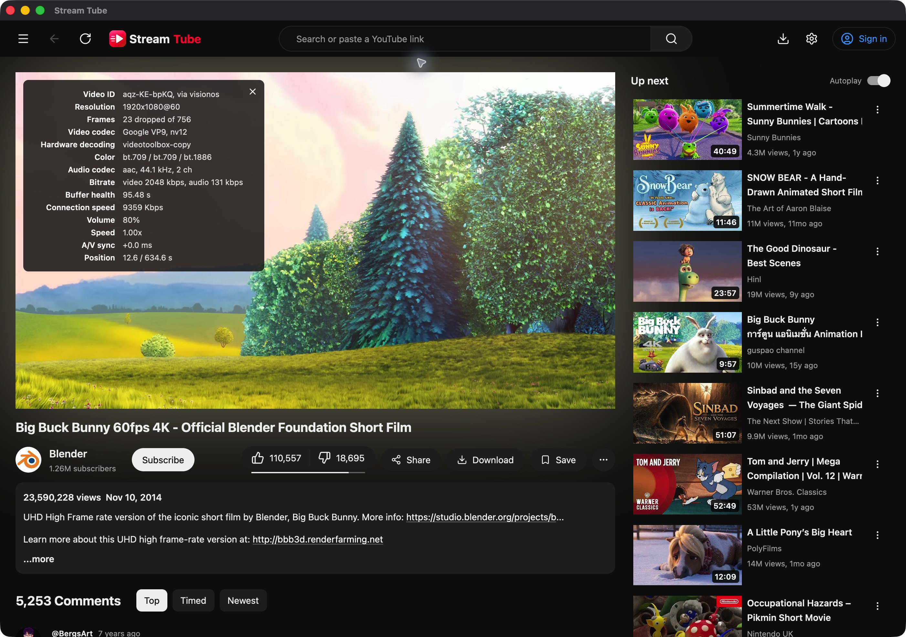
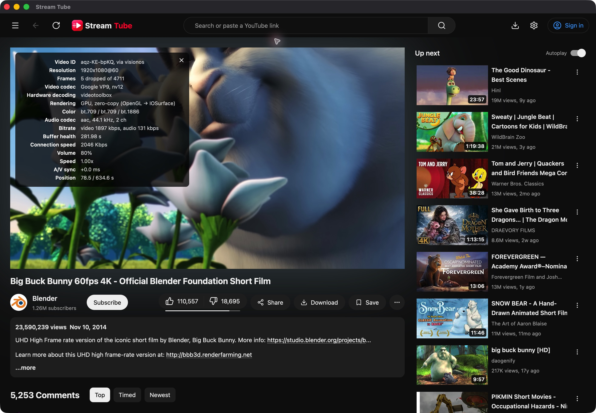

# macOS verification: 0.7.3-alpha

Checked on **2026-11-25**, on a physical **Apple M4 Mac (Mac16,13)** running
**macOS 26.6.2 (25G83), arm64**. Each app used a separate `STREAMTUBE_DATA_DIR` profile.

Two builds were run:

| Build | Source |
| --- | --- |
| Published ZIP | [`StreamTube-0.7.3-alpha-macos-arm64-UNOFFICIAL.zip`](https://github.com/Avaneesh-Inamdar/Stream-Tube-Desktop/releases/tag/v0.7.3-alpha) |
| Local release build | [`7f295ec91de9e1145b251bedaca1e8d5299f45ed`](https://github.com/Avaneesh-Inamdar/Stream-Tube-Desktop/commit/7f295ec91de9e1145b251bedaca1e8d5299f45ed), `community/macos-apple-silicon` |

The local build includes #113 (window size persistence) and #114 (GPU video
rendering), merged after the published ZIP. Their rendering results are recorded
separately below.

## Build and automated checks

Toolchain: Rust **1.100.0**, Xcode **26.6 (17F113)**, macOS SDK **26.5**.
Runtime dependencies: Homebrew mpv **0.42.0_1**, FFmpeg **9.1**, yt-dlp **2026.11.23**.

Run from the repository root at the source commit above:

```sh
RUSTUP_TOOLCHAIN=1.100.0 bash packaging/macos/build-app.sh
cargo +1.100.0 test --release --locked
```

The build produced an arm64 `Stream Tube.app`. The default test suite finished
with **53 passed, 0 failed**.

Three opt-in playback tests passed using a generated 12-second, 1280×720 H.264
video at 30 fps:

```sh
mpv_test_dir=$(mktemp -d)
ffmpeg -f lavfi -i testsrc2=size=1280x720:rate=30 -t 12 \
  -c:v libx264 -preset ultrafast -pix_fmt yuv420p "$mpv_test_dir/mpv-check.mp4"
STREAMTUBE_MPV_TEST_VIDEO="$mpv_test_dir/mpv-check.mp4" \
  cargo +1.100.0 test --release --locked player::mpv::tests:: \
  -- --ignored --nocapture --test-threads=1
```

- Software rendering: `hwdec-current=no`.
- VideoToolbox with software rendering: `hwdec-current=videotoolbox-copy`.
- OpenGL/IOSurface: Apple M4 renderer, `videotoolbox` decoding, 120 frames with
  buffers retained by the consumer, resizing to 16×16 and back, redraw while
  paused, and screenshot output.

Seven opt-in network tests also passed:

```sh
cargo +1.100.0 test --release --locked -- --ignored --exact \
  api::innertube::tests::live_search \
  api::innertube::tests::live_watch \
  api::innertube::tests::live_channel_playlist \
  api::innertube::channel_tab_tests::channel_tabs_have_kinds_in_other_languages \
  api::innertube::long_playlist_tests::long_playlists_load_and_watch_next_sends_a_window \
  api::services::tests::live_services \
  player::proxy::live_proxy_tests::serves_real_streams_only_with_the_secret \
  --test-threads=1
```

These cover search, watch metadata, comments and replies, channel and playlist
loading, channel tabs in Turkish, playlists beyond 300 videos, SponsorBlock,
DeArrow, Return YouTube Dislike, and real streams through the local proxy. The
proxy test confirms HTTP **403** for the same stream path without its secret.

## Foreground checks: published ZIP

All of these passed in the downloaded app:

- Home loaded videos and thumbnails. Pasting a YouTube URL opened its watch page,
  recommendations and comments.
- [Big Buck Bunny](https://www.youtube.com/watch?v=aqz-KE-bpKQ) played at
  **1920×1080, 60 fps**, VP9 video and AAC audio. Stats for nerds reported
  **`videotoolbox-copy`**.
- Play/pause, seeking forward by 10 seconds, mute/unmute, and switching playback
  speed to 1.25× and back to 1× worked.
- Native fullscreen and windowed fullscreen opened; Escape returned to the watch page.
- PiP replaced the main surface with its placeholder. Return to player restored
  the paused frame at **42.2 seconds**, preserving the paused state.
- `⌘T`, `⌘1` and `⌘W` opened, selected and closed tabs. Browsing another page
  showed the video in the miniplayer.
- Save → Create new playlist created **Mac verification**, containing the video,
  without a crash. It appeared under Playlists with one video. The playlist and
  playback progress persisted after quitting; SQLite `PRAGMA quick_check` returned `ok`.
- Settings opened from the native application menu and with `⌘,`. About opened
  its own section from the application menu.
- English → Russian → English and dark → light → dark updated the interface.
- Before mpv was installed, About and the player showed the `brew install mpv`
  instruction. After installation and restart, playback worked.
- The isolated profile directory was `0700`; its instance listener refused
  requests with missing or incorrect secrets.



## Foreground checks: local source build

- The same YouTube video played at **1920×1080, 60 fps**. Stats for nerds reported
  **`videotoolbox`**, **`GPU, zero-copy (OpenGL → IOSurface)`**.
- Resuming playback while PiP was open advanced the position from **78.9 seconds**.
  Return to player restored the main video at **112.7 seconds**, still playing.
- Native fullscreen opened and Escape restored the watch page.
- Launching with `PATH=/usr/bin:/bin:/usr/sbin:/sbin` still found Homebrew's libmpv
  and yt-dlp. About displayed `libmpv` and yt-dlp `2026.11.23`.
- A second launch with a `streamtube://open?url=…` link and `t=30` navigated the
  running app to that position. The second process exited successfully and the
  original process remained the only instance.
- Three consecutive launch/quit cycles saved the same **1402×974** window size.
  The profile was `0700`, its database `0600`, and SQLite `PRAGMA quick_check`
  returned `ok`.



## Package checks

Both bundles passed `codesign --verify --strict` and `plutil -lint` on
`Contents/Info.plist`. `lipo -archs` reported `arm64`; `vtool -show-build`
reported a deployment target of macOS 11.0.

The downloaded ZIP's SHA-256 matched GitHub's release asset metadata:

```text
e116fdbc9253a565333f5fb1ff018a8526d64d8066f030a033b481b84f3b5310
```

The published `SHA256SUMS.txt` contains the Windows/Linux files, with no macOS ZIP
entry. Running `gh attestation verify` for this ZIP returned HTTP **404** from
GitHub's attestation endpoint. The bundle's ad hoc code signature passed verification.
