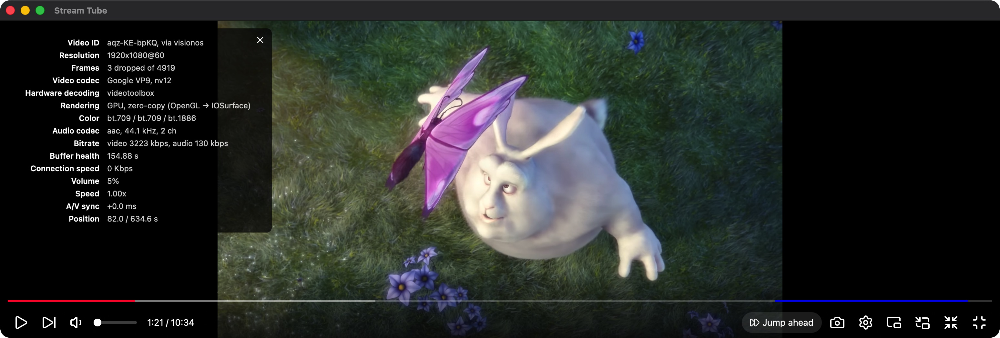
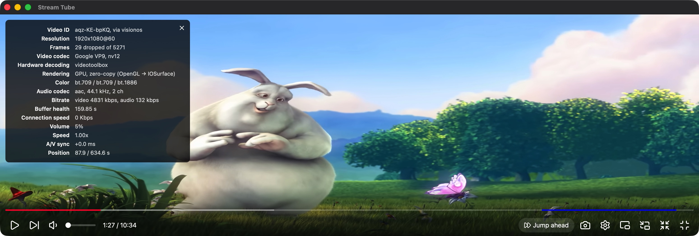

# macOS verification: 0.7.4-alpha fixes

Checked on **2026-11-25**, on a physical **Apple M4 Mac (Mac16,13)** running
**macOS 26.6.2 (25G83), arm64**, using an isolated `STREAMTUBE_DATA_DIR`.
The local release build contains the fixes through
[`323cc8c`](https://github.com/ShiroKSH/Stream-Tube-Desktop/commit/323cc8c).

Toolchain: Rust **1.100.0**, Xcode **26.6 (17F113)**, macOS SDK **26.5**.
Runtime: Homebrew mpv **0.42.0_1**, FFmpeg **9.1**, yt-dlp **2026.11.23**,
Google Chrome **158**.

## Changes checked

- `Z` cycles all seven aspect modes again. The macOS merge had omitted its
  keyboard handler.
- GPU frames use the same aspect calculation and player clipping as software
  frames. The rendering path remains **VideoToolbox → OpenGL → IOSurface**.
- Auto mode samples a 96×96 grid from the pixel buffer every tenth frame and
  feeds the existing black-bar detector. Full video frames stay on the GPU.
- Browser login uses a normal Chrome window for Google credentials. A separate
  headless process reads only the app-owned temporary profile's YouTube session
  over private pipes after sign-in. The temporary directory is created as `0700`.
- The macOS workflow packages a matching `.zip.sha256` beside each ZIP and
  verifies it before upload. Push and manual runs attest both files in a separate
  job; PR builds have no attestation or identity-token write permission.

## Build and automated checks

```sh
RUSTUP_TOOLCHAIN=1.100.0 bash packaging/macos/build-app.sh
cargo +1.100.0 check --release --locked
cargo +1.100.0 test --release --locked
```

The build produced an arm64 `Stream Tube.app`. Code-signature verification and
plist validation passed. The default suite finished with **66 passed, 0 failed**.
The two new regression tests cover black bars in a real 420F `CVPixelBuffer` and
YouTube login detection in both Chrome cookie database locations. The latter
rejects Google cookies, lookalike domains and incomplete sessions.

Three opt-in playback tests passed with a generated 12-second, 1280×720 H.264
video at 30 fps:

```sh
STREAMTUBE_MPV_TEST_VIDEO=/path/to/mpv-check.mp4 \
  cargo +1.100.0 test --release --locked player::mpv::tests:: \
  -- --ignored --nocapture --test-threads=1
```

These exercised software rendering, VideoToolbox-copy, and Apple M4 OpenGL with
retained IOSurfaces, resizing, paused redraw and screenshot output.

Seven opt-in network tests passed:

```sh
cargo +1.100.0 test --release --locked -- --ignored --exact \
  api::innertube::tests::live_search \
  api::innertube::tests::live_watch \
  api::innertube::tests::live_channel_playlist \
  api::innertube::channel_tab_tests::channel_tabs_have_kinds_in_other_languages \
  api::innertube::long_playlist_tests::long_playlists_load_and_watch_next_sends_a_window \
  api::services::tests::live_services \
  player::proxy::live_proxy_tests::serves_real_streams_only_with_the_secret \
  --test-threads=1
```

These checked live search, watch metadata, comments/replies, channels, playlists
beyond 300 videos, Turkish channel tabs, optional services, and stream proxy
requests with and without the required secret.

The opt-in `api::web::devtools_pipe_tests::talks_to_the_browser_over_pipes`
test passed against installed Chrome. Total: **77 passed checks** across these
runs. `actionlint` accepted both changed workflows; `git diff --check` passed.

## Foreground checks

[Big Buck Bunny](https://www.youtube.com/watch?v=aqz-KE-bpKQ) played at
**1920×1080, 60 fps**, VP9/NV12 video and AAC audio. Stats for nerds reported
**`videotoolbox`** and **GPU, zero-copy (OpenGL → IOSurface)**.

In a wide window, `Z` selected Original, Auto, Fill, Stretch, 21:9, 18:9 and 32:9.
Fill cropped to the window, Stretch filled it with changed proportions, and 21:9
expanded the visible band. The setting persisted in `settings.json`. Pausing,
resuming, resizing, windowed fullscreen and opening Settings with `⌘,` worked.
Fixed ratio modes crop letterbox bands; compare them in a sufficiently wide
player, since a narrower player can show the same picture as Original.

Original:



Stretch:



The browser Connect flow opened ordinary Chrome without a remote-debugging flag.
Submitting the account email reached Google's password screen; the previous
Google rejection before password entry did not recur.

## Package checks

The locally built ZIP passed `unzip -tq`, and its paired SHA-256 file passed
`shasum -c`. SHA-256:

```text
3ecbb4228e6acb7a86ec23ca211f1c856224c6e2465d2b01139aa5a8984e176f
```

The already-published 0.7.4-alpha macOS ZIP has a different digest:

```text
70a6f292b8bddd0d59ffb6cbf22a681e85d6002e45777b32b7a891edb0d7f39e
```

That published ZIP matched GitHub's asset digest. Its release checksum file
omits the Mac ZIP and the attestation lookup returned HTTP 404. The workflow
changes apply to future builds. Local bundles use an ad hoc signature.

The [0.7.3-alpha report](macos-0.7.3-verification.md) preserves the earlier
published-package and Mac runtime observations.
